# Score

Score is a local-first web app for running a team of [Hermes Agent](https://github.com/NousResearch/hermes-agent)
profiles. One screen shows what every agent is doing right now, agents hand work to each other with `@mentions`
in Chat rooms, and anything that needs your decision (an approval, a review) waits for you in one place.
It runs on your machine, keeps its own data in `~/.score`, and talks to Hermes through the `hermes` CLI and the
gateway API. It never reads your Hermes credential files and never writes Hermes databases.

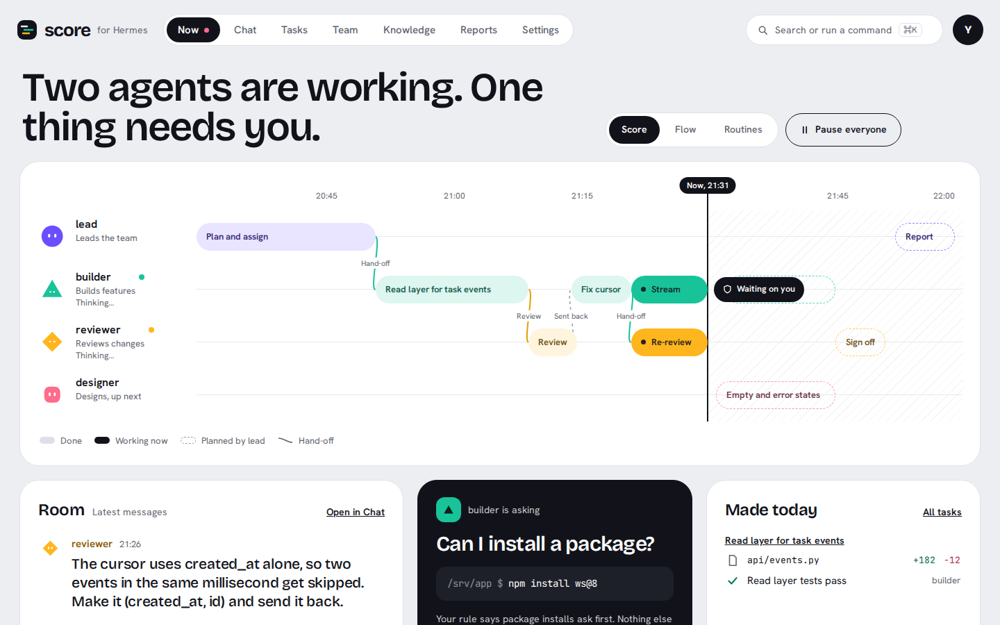

(The screenshots show the built-in demo team: `lead`, `builder`, `reviewer`, `designer`.)

## Setup

Score runs on Linux (tested on Ubuntu 26.04, x86_64). Every step below installs into your home folder unless it says
**sudo**. Steps 1–2 give you the demo (no Hermes, no model calls); steps 3–6 connect your real Hermes agents.

### 1. Prerequisites

You need `git`, `curl`, `tar` and `xz`, plus **Node.js 24** and **pnpm 12**. Node without sudo:

```bash
V=v24.21.0; D=node-$V-linux-x64
mkdir -p ~/.cache ~/.local/opt ~/.local/bin && cd ~/.cache
curl -fsSLO https://nodejs.org/dist/$V/$D.tar.xz
curl -fsSL https://nodejs.org/dist/$V/SHASUMS256.txt | grep " $D.tar.xz\$" | sha256sum -c -
tar -xJf $D.tar.xz -C ~/.local/opt && rm $D.tar.xz
for b in node npm npx corepack; do ln -sf ~/.local/opt/$D/bin/$b ~/.local/bin/$b; done
corepack enable --install-directory ~/.local/bin
export COREPACK_ENABLE_DOWNLOAD_PROMPT=0
node -v && pnpm -v          # v24.21.0 and 12.9.1
```

`~/.local/bin` must be on your `PATH` (it is on Ubuntu once the folder exists; log out and in if `node` isn't found).
nvm, fnm or mise work too (the repo has a `.node-version`). Optional extras:

- **uv** (only to run the bridge plugin's tests): [docs/SETUP.md](docs/SETUP.md) §1c.
- **Web terminal**: needs a C++ toolchain, **sudo** `apt install build-essential python3`, then `pnpm rebuild node-pty`.

### 2. Get Score and try the demo

```bash
git clone <repo-url> ~/score && cd ~/score
pnpm install
pnpm build
pnpm start                  # http://127.0.0.1:8740 with a built-in demo team; Ctrl+C stops it
```

The terminal prints a one-time **pairing link** (`Pair this browser: …/pair#…`). Open it once in your browser; until a
browser is paired you can look around but not change anything (see [Pairing](#pairing)). `pnpm dev` runs the same
demo with live reload for development (web on port 5173).

### 3. Install Hermes Agent

Skip this if Hermes already runs on this machine. Install it with Hermes's own installer, then run its setup wizard
(model provider, keys) and start its gateway:

```bash
curl -fsSL https://hermes-agent.nousresearch.com/install.sh | bash
hermes setup
hermes gateway start
```

Score is tested with Hermes **v0.21.x**. More in the [Hermes Agent README](https://github.com/NousResearch/hermes-agent).

### 4. Connect Score to Hermes

1. **Give Score an API key for each Hermes profile** (Score keeps its copies in `~/.score/hermes-keys/`, mode 0600). These
   commands change Hermes's config and restart its gateway — read them first:

   ```bash
   umask 077; mkdir -p ~/.score/hermes-keys
   python3 -I -c 'import secrets;print(secrets.token_urlsafe(32))' > ~/.score/hermes-keys/default
   hermes config set API_SERVER_KEY "$(cat ~/.score/hermes-keys/default)"
   hermes gateway restart
   # every other profile Score should drive (replace <profile>):
   python3 -I -c 'import secrets;print(secrets.token_urlsafe(32))' > ~/.score/hermes-keys/<profile>
   hermes -p <profile> config set API_SERVER_KEY "$(cat ~/.score/hermes-keys/<profile>)"
   ```

2. **Install the Score bridge plugin** into each profile (it reports activity to Score and powers approvals, rewind,
   compact and the context meter):

   ```bash
   ln -s ~/score/hermes-plugin/score_bridge "<profile home>/plugins/score-bridge"   # default profile home: ~/.hermes
   hermes -p <profile> plugins enable score-bridge
   hermes gateway restart
   ```

3. **To create agents from Score** (Team › Add agent), tell Score where to install the plugin from, pinned to a commit:

   ```bash
   export SCORE_BRIDGE_INSTALL_URL="file://$HOME/score#hermes-plugin/score_bridge"
   export SCORE_BRIDGE_INSTALL_REF="$(git -C ~/score rev-parse HEAD)"
   ```

### 5. Run Score with your agents

```bash
SCORE_MODE=live scripts/score start    # runs in the background and prints a pairing link
scripts/score status                   # is it running, which URL
curl -s http://127.0.0.1:8740/api/system   # "reachable": true means Score sees Hermes
```

Other launcher commands: `scripts/score pair` (a fresh pairing link), `password` (security password for managing
devices and the terminal), `logs -f`, `stop`, `restore <backup>`. To start Score with the machine, use the systemd user
unit in [docs/SETUP.md](docs/SETUP.md) §9.

### 6. Use Score from your phone or another computer (HTTPS)

Score listens only on `127.0.0.1` by default. The quickest safe way in from another computer is an SSH tunnel:
`ssh -N -L 8740:127.0.0.1:8740 <user>@<host>`, then open `http://127.0.0.1:8740`.

For phones and day-to-day use, turn on **remote mode** (always HTTPS). With Score's own certificate (replace the
address with this machine's):

```bash
SCORE_HOST=192.168.1.20 SCORE_PUBLIC_ORIGINS=https://192.168.1.20:8741 scripts/score tls
SCORE_MODE=live SCORE_REMOTE=1 SCORE_HOST=192.168.1.20 scripts/score start   # https://192.168.1.20:8741
```

Install `~/.score/tls/ca.crt` on each device once (the page at `https://<host>:8741/setup/https` walks you through
it). With **Tailscale** you can skip that: `scripts/score tailscale` fetches a real certificate for the machine's
`ts.net` name. Details, including both at once: [docs/SETUP.md](docs/SETUP.md) §6b.

### Optional extras

- **Coding agents** (Team › Add agent › Coding agent): install and sign in to
  [Claude Code](https://docs.claude.com/claude-code), [Codex CLI](https://github.com/openai/codex) or
  [Antigravity `agy`](https://antigravity.google/docs/cli/install/) yourself; Score uses your own login and quota.
- **Web terminal**: start Score with `SCORE_TERMINAL=1` in remote mode and set a password with `scripts/score password`.
- **Knowledge vault**: notes live in `~/score-vault` (a git repository Score creates); set `SCORE_VAULT` to move it.

### Upgrading

```bash
scripts/score stop
cp -a ~/.score ~/.score-backup-$(date +%F)        # database, media, keys
git -C ~/score pull && pnpm install && pnpm build
SCORE_MODE=live scripts/score start               # migrations run automatically at start
```

If you use the bridge plugin by copy instead of symlink, copy `hermes-plugin/score_bridge` again and restart the
gateway. All settings (`SCORE_PORT`, `SCORE_HOME`, …) are listed in [docs/SETUP.md](docs/SETUP.md).

## Pairing

Score has no user accounts. A browser proves it may control Score by opening a one-time pairing link, which only
someone with access to the server's terminal (or `$SCORE_HOME`) can get.

- The link is printed at startup, is valid for 15 minutes and works once. A newer link replaces an older one.
- From a browser that is already paired: Settings › Remote access › **Pair another device** (needs the security
  password). Or run `scripts/score pair`.
- A paired browser stays paired for up to 30 days (7 days without use). Clearing cookies unpairs it.

## Create and manage agents

Team, then Add agent, creates a Hermes profile (blank or copied from an existing agent), installs the bridge plugin
into it and gives it a color and shape. Before the first use, tell Score where to install the plugin from:

```bash
export SCORE_BRIDGE_INSTALL_URL='https://<your git host>/<you>/score.git#hermes-plugin/score_bridge'   # or 'file:///home/<you>/score#hermes-plugin/score_bridge'
export SCORE_BRIDGE_INSTALL_REF=<full 40-character commit hash>
```

Without these, Add agent stops with "Configure a pinned bridge installation URL first." The `#hermes-plugin/score_bridge` part selects the plugin inside the repository. (Only `https://` and
`file://` URLs are accepted, and the ref must be a full commit hash, not a tag or branch name.) Each step of a
create or delete is previewed before it runs. Deleting an agent asks you to type its name and keeps a private
export in `$SCORE_HOME/profile-backups/`. Details: [docs/SETUP.md](docs/SETUP.md) section 8.

## What is in the app

Score has seven destinations along the top: Now, Chat, Tasks, Team, Knowledge, Reports and Settings.
[docs/USER-GUIDE.md](docs/USER-GUIDE.md) describes the main ones in detail. All pictures below come from the built-in
demo team (`lead`, `builder`, `reviewer`, `designer`); `pnpm screenshots` regenerates them.

### Now: Score, the live timeline


One row per agent, time running left to right. Solid blocks are work in progress, dashed blocks are what the lead
has planned, and a dark block means an agent is waiting on you. Below it sit the latest thread, any approval that
needs your decision and a message box. **Pause everyone** stops all agents at once.

### Flow: the graph of one run

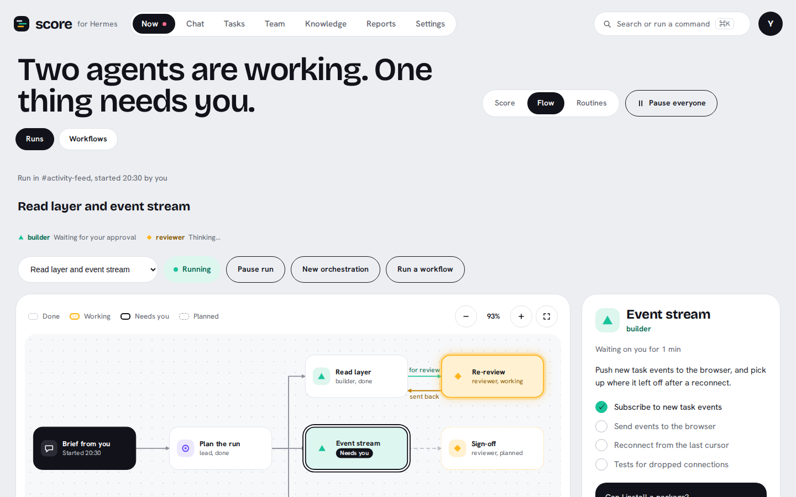

A run is one of your messages plus everything it caused. Click a step to see who is doing it, its checklist and any
approval it is waiting on, and to stop it or pause the whole run.

### Orchestrations: a lead agent runs a goal

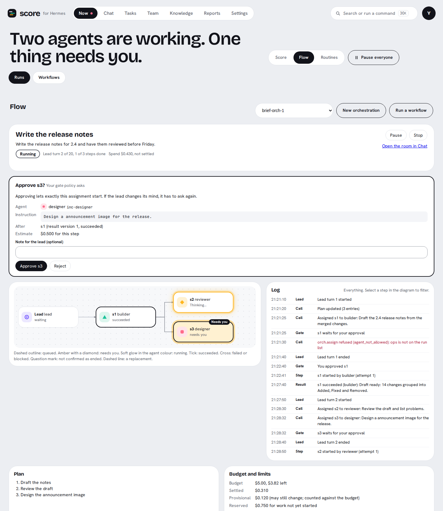

Give a lead agent a goal and it plans the steps and hands them to your team. The live diagram shows each step as it
runs, the log records every request the lead made, and the plan and budget sit below. Score checks each request
against the limits, the budget and your approval choice, and steps can wait for your approval before they start.

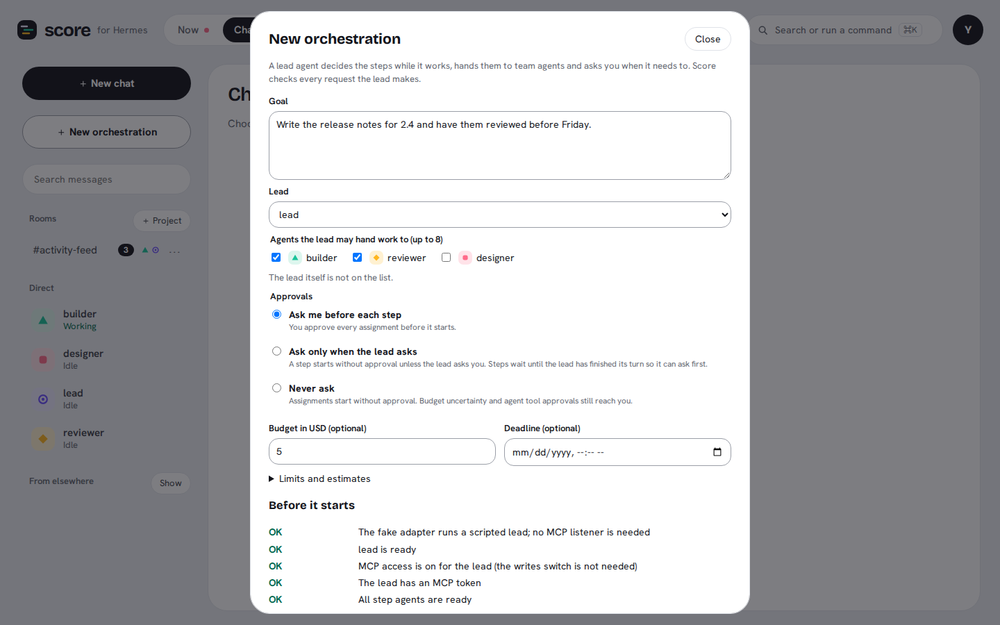

Start one from Chat or from Flow with **New orchestration**: choose the lead, which agents it may hand work to, when
you want to be asked (before each step, only when the lead asks, or never) and an optional budget or deadline.

### Workflows: draw the steps yourself

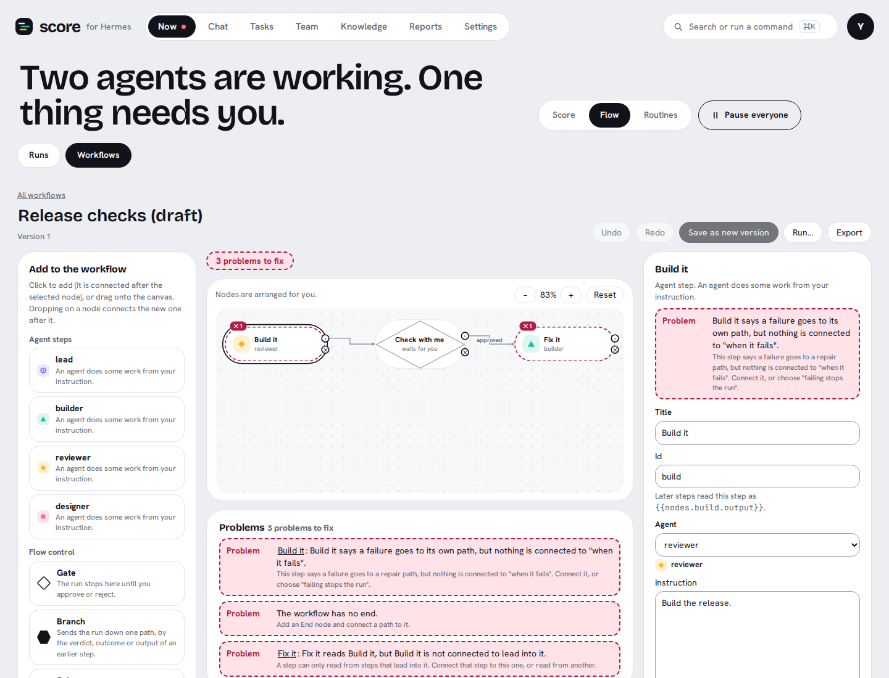

Where an orchestration lets a lead agent plan, a workflow is a graph you draw: agent steps, gates that wait for your
approval and branches that choose a path from a step's result. The editor checks the drawing as you go and saves
versions you can run later.

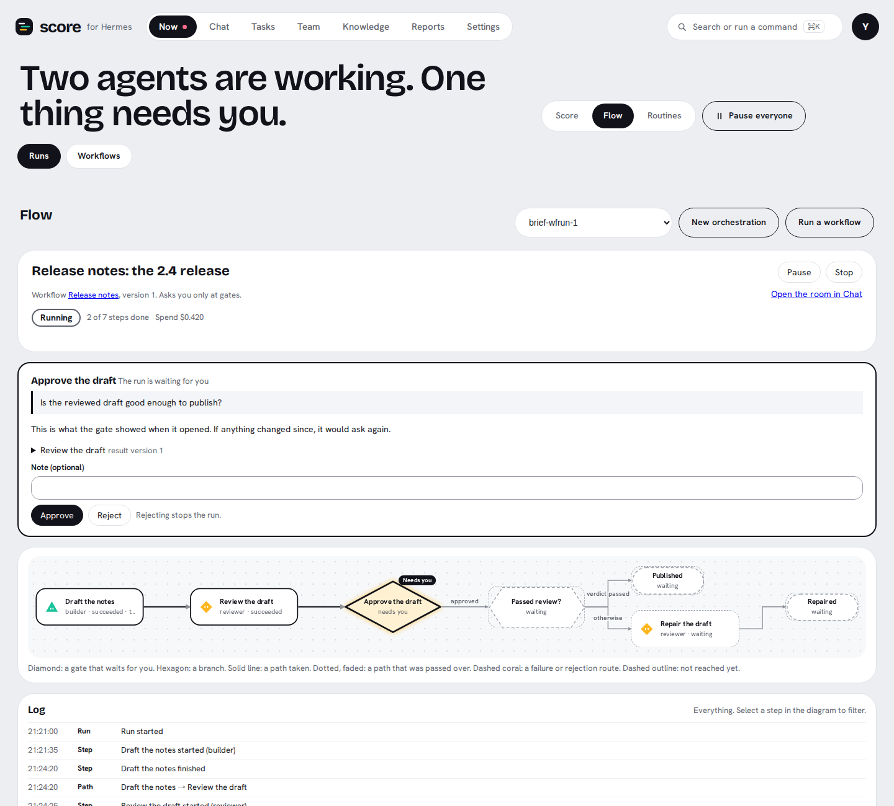

A run asks for approval only where you placed a gate (or before every step, if you choose), draws itself live on the
diagram and keeps a plain-language log you can replay.

### Watch: replay what an agent did

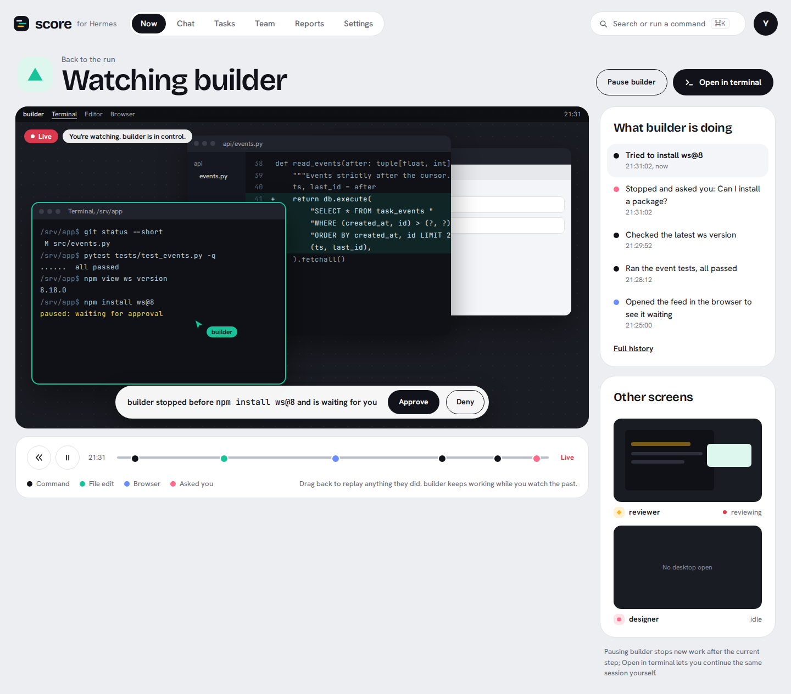

Watch replays an agent's recorded work: its terminal, the files it changed and the pages it looked at, with a
timeline you can drag back. It is a replay of events, not a remote view of a screen. From here you can pause the
agent or copy a command to continue its session in your own terminal.

### Chat: rooms and direct conversations

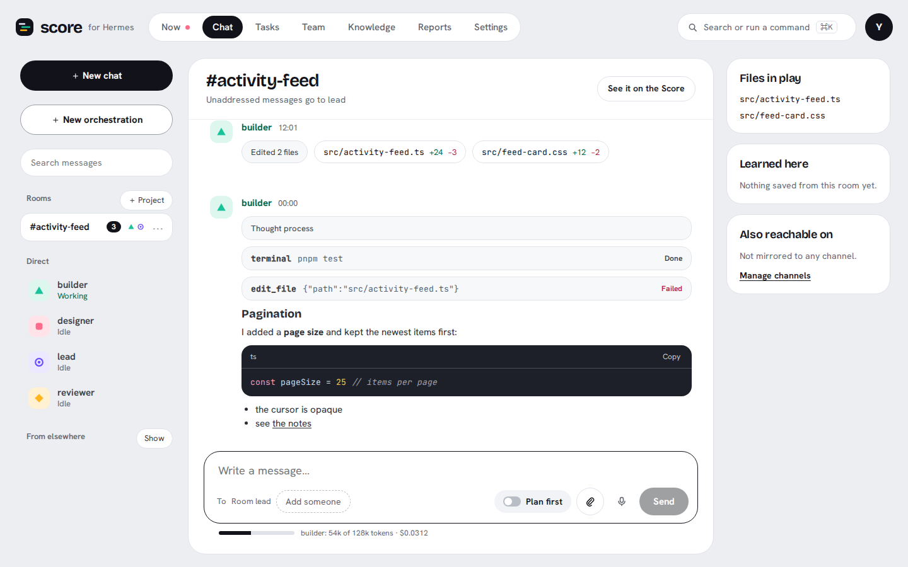

Rooms and direct chats with your agents. Mention `@agent` to hand work over, use `/assign` and `/routine` to create
tasks and schedules, and expand tool cards to see what an agent ran. Rooms keep a list of the files in play.

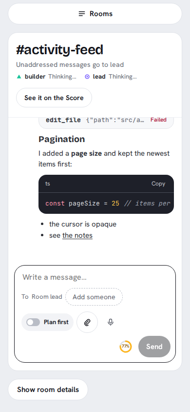

Score is usable on a phone: the same pages reflow to one column.

### Tasks: the board

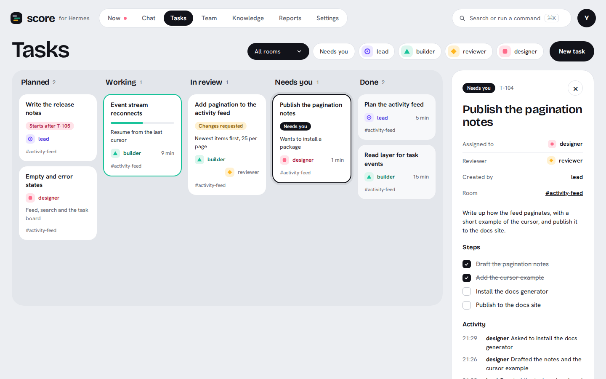

Planned, Working, In review, Needs you and Done, with filters by room and agent. Open a card to see its steps and
activity, and approve or comment right in the drawer.

### Team and agent pages

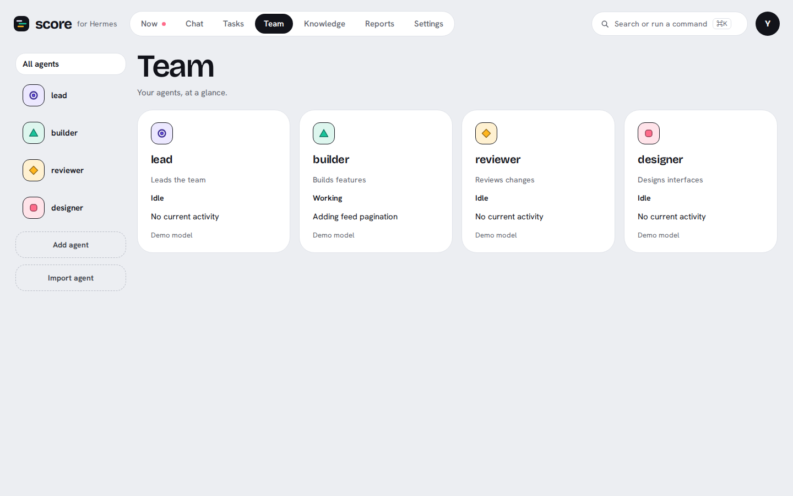

Every agent at a glance. **Add agent** creates a new Hermes profile or imports an existing one.


Each agent has a page with tabs for personality, model, skills, memory, tools, plugins, workspace, routines,
channels, permissions and history.

### Coding agents

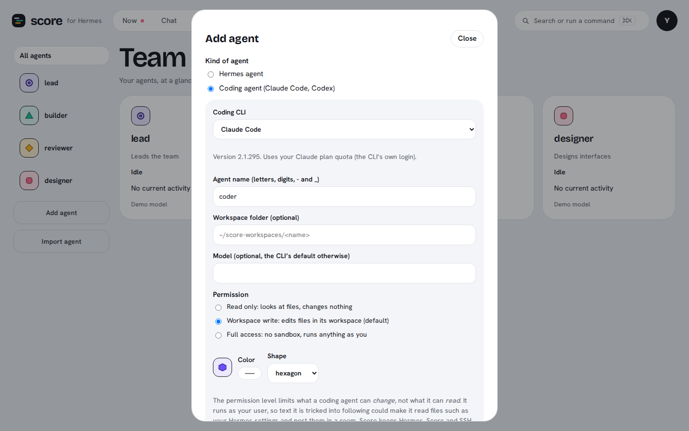

Claude Code, Codex CLI and Antigravity (`agy`) can join the team next to your Hermes agents. Pick the CLI, a
workspace folder and a permission level (read only, workspace write or full access); the agent then works in rooms like
any other member. They use your own CLI login and plan quota (Codex and Antigravity show the limits left). For Claude
Code and Codex the permission level limits what they can change, not what they can read; Antigravity's sandbox also keeps
reads inside the workspace below full access.

### Knowledge: your notes

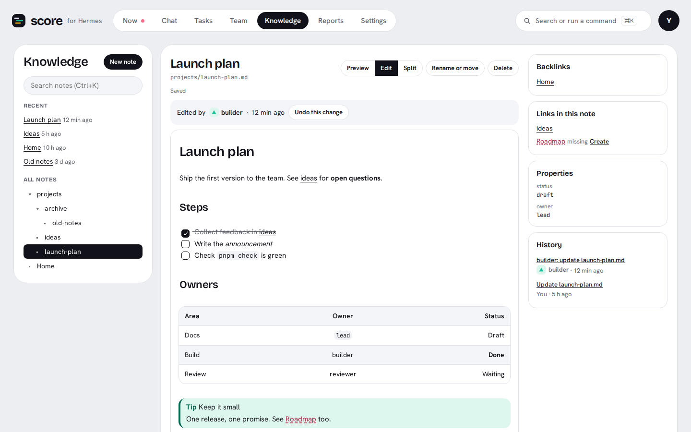

A folder of Markdown notes that you and your agents share. The editor shows Markdown rendered as you type and keeps
the file as plain text; notes link to each other, show backlinks, properties and history, and edits made by an agent
carry its name and can be undone.

### Reports

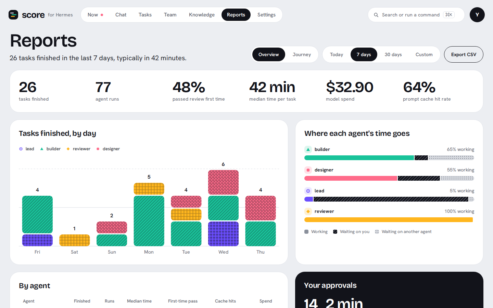

Tasks finished per day, where each agent's time goes, review pass rate, spend and your approvals, for today, 7 days,
30 days or a custom range. **Export CSV** saves the numbers.

### Settings

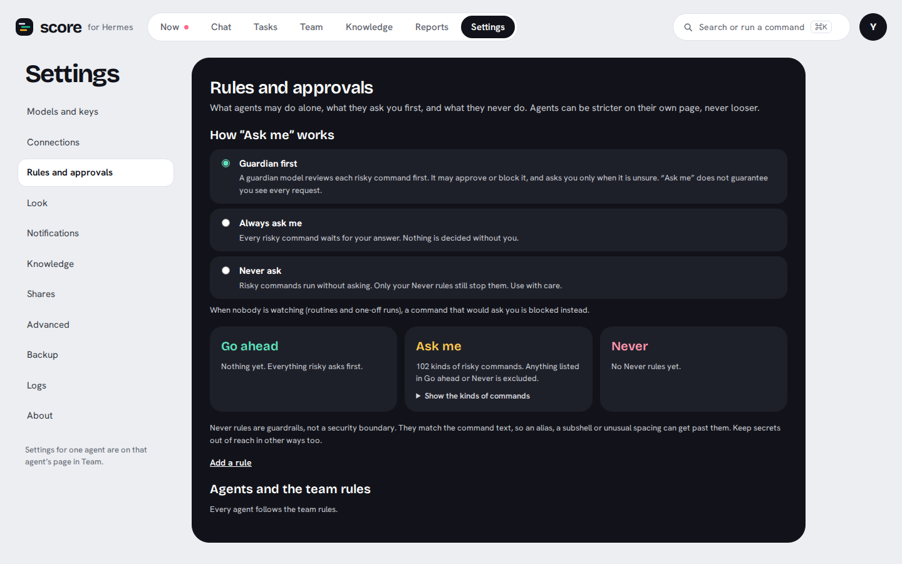

Models and keys, connections, rules and approvals (what agents may do alone, what they ask first and what they never
do), notifications, Knowledge, shares, every Hermes setting under Advanced, backup, logs and remote access.

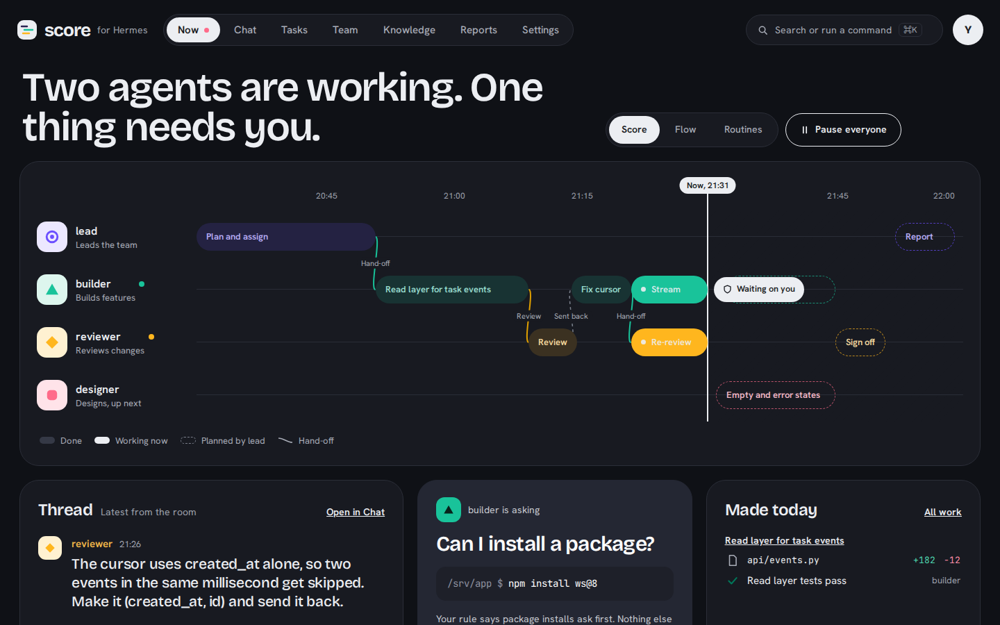

Settings › Look switches between light and dark.

### Terminal

Score can also open a terminal on the machine it runs on, in the browser. It is off by default (start Score with `SCORE_TERMINAL=1`) and works only over
HTTPS in remote mode, with a security password set on the host (`scripts/score password`); open terminals are listed
and can be closed under Settings. There is no screenshot because it needs a real shell, which the demo does not run.

## Troubleshooting

**The browser says "Pair this browser" or an action fails with "not paired".** This browser has not been paired,
or its pairing expired. Open the pairing link from the server terminal. If it is older than 15 minutes, was
already used, or has scrolled away: `scripts/score pair` (launcher), restart the server, or type `pair` in the
server terminal (any mode, when it runs in a terminal).

**"This pairing link is invalid or expired."** Same remedy: mint a new link. Only the newest link works.

**"Score is not built yet. Run `pnpm build` first."** `pnpm start`, `scripts/score start` and remote mode serve the
built web app, so `pnpm build` has to run first (and again after every `git pull`).

**"listen EADDRINUSE: address already in use 127.0.0.1:8740".** Another program (maybe another Score) holds the
port. Pick another with `SCORE_PORT=8750`, or stop the other one: `scripts/score stop`, or find it with
`ss -ltnp | grep 8740`.

**"Another Score server (pid N) is using <path>".** Two Score servers must not share one `SCORE_HOME`. Stop the other
one, or give this one its own `SCORE_HOME`. Do not mix the launcher and systemd for the same home.

**Hermes is unreachable (live mode).** Run `curl -s http://127.0.0.1:8740/api/system` and read `degraded`.
"Gateway unreachable": the Hermes gateway is not running or has no API server key (SETUP section 7; check
`curl -s http://127.0.0.1:8642/v1/health`). "<profile>: credentials unavailable": that profile has no key in
`~/.score/hermes-keys/`. `SCORE_HERMES_URL` and `SCORE_HERMES_HOME` point Score at a gateway or Hermes home in a
non-default place. If nothing shows up in the timeline although Hermes runs, check the bridge plugin: it must be
enabled in each profile, and the `bridge.producers` count in the same endpoint shows how many are connected.

**A browser on another machine gets "Request host is not allowed" or a 403.** In remote mode the address in the
browser must match one of the `SCORE_PUBLIC_ORIGINS` exactly (scheme, host and port). `localhost` and `127.0.0.1`
are different hosts.

**The server will not start in remote mode.** The message names the problem. Typical ones: a non-loopback
`SCORE_HOST` without `SCORE_REMOTE=1`; `SCORE_PUBLIC_ORIGINS` missing; plain HTTP
without `SCORE_REMOTE_INSECURE_HTTP=accept`; `SCORE_TLS_CERT` without `SCORE_TLS_KEY`; or the browser port equal to
`SCORE_BRIDGE_PORT`.

**Add agent says "Configure a pinned bridge installation URL first."** Set `SCORE_BRIDGE_INSTALL_URL` and
`SCORE_BRIDGE_INSTALL_REF` (see above) and restart Score.

**I need more detail in the log.** `scripts/score logs -f`, or the terminal where `pnpm start` runs. Request logs
redact cookies and authorization headers.

**Codex-free.** Score needs no Codex, OpenAI or other cloud account to run. Codex CLI is only a tool the maintainers
use to write code (see [CLAUDE.md](CLAUDE.md)); nothing in the app calls it. In demo mode no model is called at
all; in live mode your own Hermes calls the providers you configured.

## For contributors

- Checks: `pnpm check` (lint, format, typecheck, tests, license check). End-to-end: `pnpm e2e` (see SETUP section 5).
- Rules for coding agents and humans: [AGENTS.md](AGENTS.md). Plan: [docs/PLAN.md](docs/PLAN.md). Architecture:
  [docs/ARCHITECTURE.md](docs/ARCHITECTURE.md). API contract: [docs/API-CONTRACT.md](docs/API-CONTRACT.md).

## License

Score is free for personal use, research and noncommercial organisations under the
[PolyForm Noncommercial License 1.0.0](LICENSE.md) (see also [NOTICE](NOTICE)). Commercial use needs a separate
license: see [COMMERCIAL.md](COMMERCIAL.md). Third-party notices: [THIRD_PARTY_NOTICES.md](THIRD_PARTY_NOTICES.md).
