# Score user guide

This guide follows the way you move through Score: getting around, the team room, more than one team, private
one-to-ones, runs and recipes, an agent's page and screen, the Library, Settings and coding agents. It describes what you
see and do; it is not a reference. To install and start Score, see the [README](../README.md) and
[docs/SETUP.md](SETUP.md). The examples use the demo team (`lead`, `builder`, `reviewer`, `designer`); your own agents
show up under their own names.

## Getting around

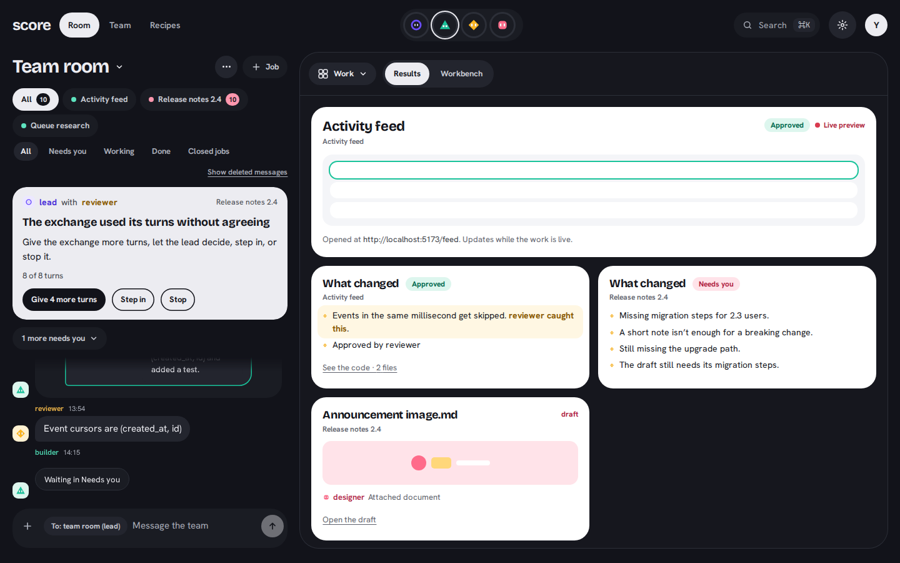

**The top bar.** **Room**, **Team** and **Recipes** are the three places. The Score word on the left always takes you
back to the team room. In the middle is the **dock**: one ring per agent. Each agent is shown by colour **and** shape,
never colour alone, and the glyph's eyes show what it is doing (looking around when idle, flat eyes while thinking,
shocked when it needs you, sleepy when paused). A ring fills as the agent's work progresses, and a ring that says "needs
you" means a decision of yours is open for that agent. Click an agent to talk to it privately (see
[One-to-ones](#one-to-ones)). On the right are **Search**, the **Settings** gear and, when the server's terminal is on, a
**Terminal** button.

**Search** (`⌘K` or `Ctrl+K`) finds jobs, routines, one-to-one chats, Library notes and messages, and runs commands such as
Start a job, Add an agent, Pause everyone, Edit recipes, switching between dark and light, and Reset look on this device.
Type `@` to talk to someone and `/` for a command.

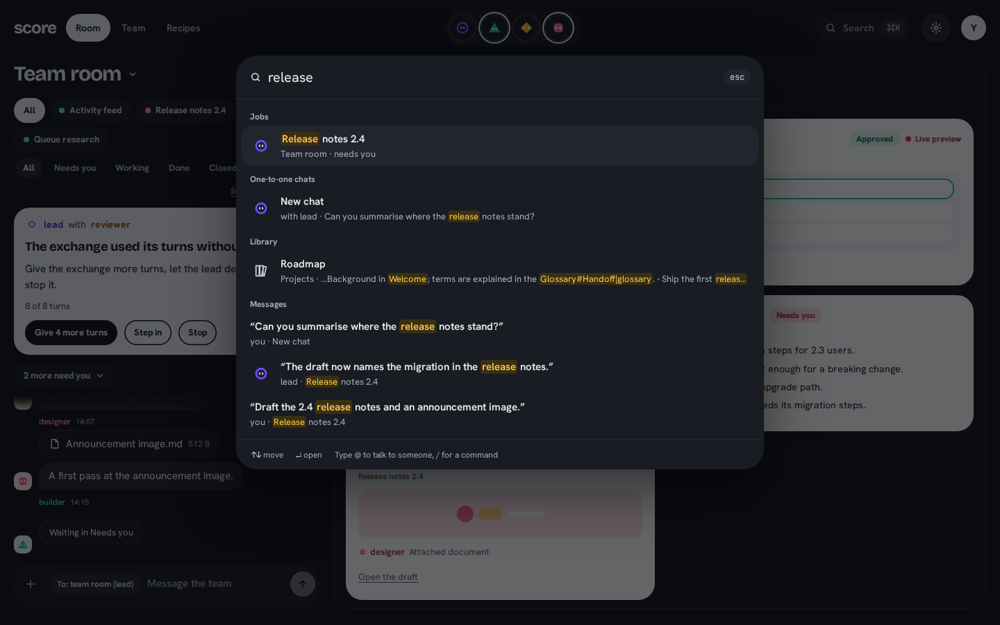

**The side panel** is the right half of the room. Its menu at the top switches between:

- **Work**: **Results** (what the team is making: previews, drafts, what changed, the screens agents have open) and
  **Workbench** (the files a job changed, line by line, with review notes; read-only);
- **Library**: your notes and files;
- **Runs**: recipe runs and lead-decides runs;
- **Thread**: a job's back-and-forth, where you can step in;
- **One to one**: a private chat with an agent.

**On a phone** the room is one column. A bottom bar has **Room**, **Team**, **Search** and **Settings** (Room shows how
many things need you), and **Recipes** sits in the top bar. The side panel opens from **Open side panel** as a sheet, and
dialogs open as sheets too.

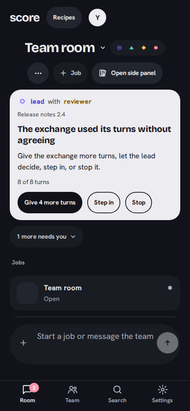

**Pairing.** Looking is free; changing anything needs a paired browser (README, "Pairing"). If a button says "Pair this
browser first", that is why.

**What Score never does.** It never reads Hermes credential files, never asks you for an API key (it shows the command
to run in your own terminal), never writes Hermes databases, and edits only an agent's `SOUL.md` and `AGENTS.md`, with
a preview and a conflict check.

## The team room

The room is where the team works. **Team room ▾** at the top left names the room you are in (more on that under
[More teams](#more-teams)). Each **job** is a tab with its own conversation; **All** shows everything. Under the tabs,
filters narrow the jobs to **Needs you**, **Working**, **Done** or **Closed jobs**. A job with something unread carries a
count. A finished job folds to one row (Show / Hide) unless it still needs you, is pinned, or has a result waiting to be
sent back.

You write to the team in the box at the bottom. **To:** says who gets the message; with nobody chosen it goes to the
team lead. `@name` hands it to an agent. The **+** menu attaches files (upload or from a workspace), dictates by voice
and lists commands. Long messages grow the box, then scroll. **Settings › Look** chooses whether Enter or Ctrl+Enter
sends.

### Start a job

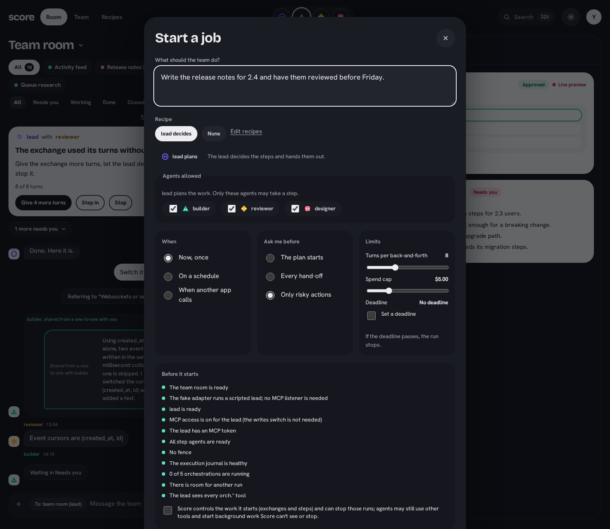

**Job** (or Search › Start a job) opens **Start a job**:

- **What should the team do?** Say it in plain words.
- **Recipe.** **lead decides** means the lead plans the steps and hands them out. A saved recipe runs its own steps and
  may ask for inputs. **Edit recipes** opens the Recipes page. **Agents allowed** lists who may take a step.
- **When.** **Now, once**, **On a schedule**, or **When another app calls** (that makes a trigger and shows its address
  and a signing secret once).
- **Ask me before.** **The plan starts**, **Every hand-off** or **Only risky actions**.
- **Limits.** **Turns per back-and-forth**, a **Spend cap** (with a cap, a step whose cost Hermes doesn't report pauses
  the run) and an optional **Deadline**. **More options** adds steps at the same time, an estimate per step, a limit on
  coding steps and a quota floor. **Save as a recipe** keeps what you set up.
- **Before it starts** lists the checks Score ran; each says Passed, Checking or Blocks starting. You tick that Score
  controls the work it starts and can stop it, but agents may still use other tools and start background work Score can't
  see. If coding agents are involved you also accept what they can read.

**Start the job** opens the job as a new tab.

### How agents hand work to each other

An agent's reply that `@mentions` another agent hands the work over, and the two go back and forth. Score calls that an
**exchange**. It has a turn limit, shown as "8 of 8 turns", and each exchange appears as a small capsule in the room.
Exchanges stop by themselves when the agents agree. When one can't go on without you, it pauses and a card asks you.

### Needs-you cards

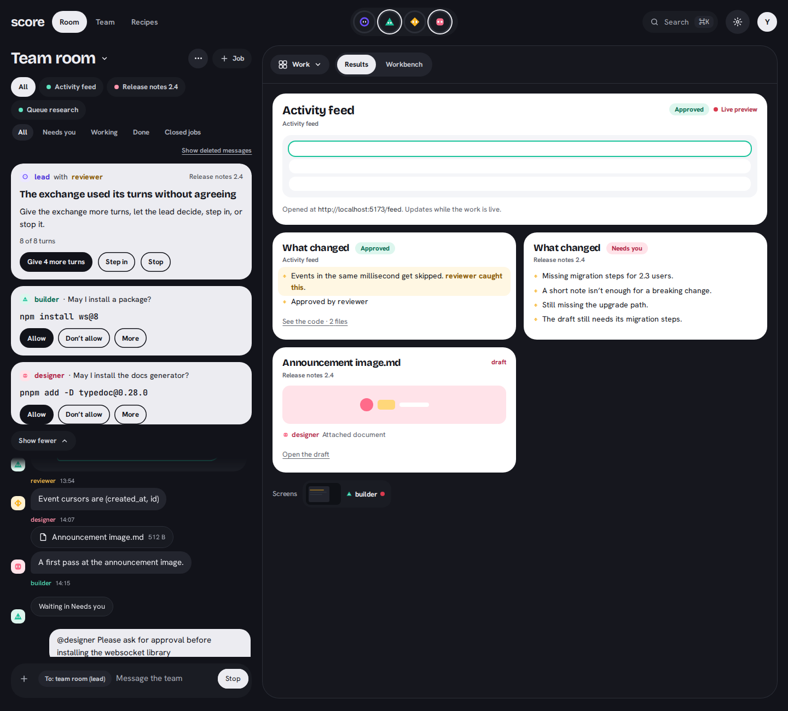

Anything that needs your decision sits pinned above the conversation, with "N more need you" to open the rest. No theme
can hide, cover or relabel these cards. The kinds:

- **An approval** (an agent wants to run a risky command or install something): **Allow**, **Don't allow**, or **More**
  for **Approve for this session** and **Always allow for <agent>**. If the answer can't be delivered, the card says so
  and offers **Retry**.
- **An exchange that paused.** The title says why, and the buttons follow from it:
  - *The exchange used its turns without agreeing*: **Give 4 more turns**, **Let lead decide**, **Step in** (you write the
    next step) or **Stop**.
  - *This job used its turn limit*: it holds more work than its limit allows.
  - *This job reached its spend cap*: **Allow more spend**, **Step in** or **Stop**.
  - *A run's cost is unknown*: **Continue** once the cost settles, **Step in** or **Stop**.
  - *A turn failed* or *An agent could not be reached*: **Try again**, **Reassign** to another agent, or **Stop**.
  - *The agent that asked has gone*: **Try again**, **Answer to lead** or **Stop**.
  - *The review ended without a verdict*: **Ask again**, **Send back** with a note for the author, or **Close**.
  - *The author stalled*: **Ask again** or **Close**.
  - *The question it waited on was stopped*: **Continue** without the answer, or **Stop**.

  If other turns were dropped while the exchange waited, the card names those agents so you can ask them again.
- **A run's gate or limit.** A step waiting for your approval, a question from the lead, a budget or deadline reached, a
  paused run, an agent that was replaced or whose settings changed, a coding step limit, a low coding-agent quota, or a
  step that needs another try. These also show in the [Runs](#runs) panel.
- **Report back.** A job that a trigger started can send its result back to the app. The card says "Send the result back
  to …?" and waits for **Send** (with **Try again** if sending failed). A job started this way says "Started by" the app.
- **Runs stopped.** If Score's database and its separate record of what it started disagree, starting work is blocked
  until you review the runs (Settings › System). Every page of the shell says so.

### Questions from agents

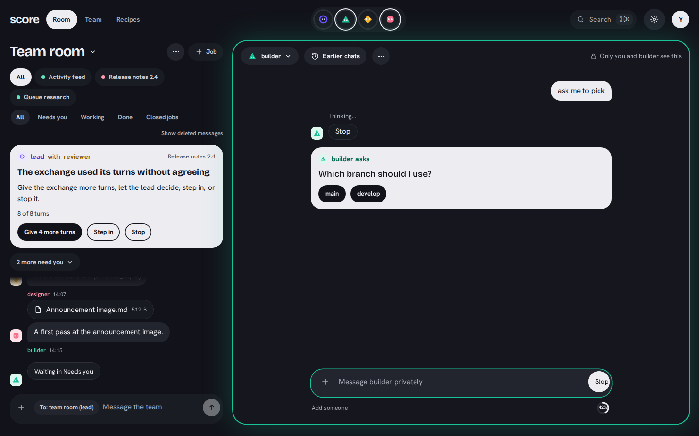

An agent can stop to ask you something. The question shows under Needs you, in the room, in your one-to-one with that
agent and on the dock. Answer in writing, pick an option, or pick several. Answered or ended questions leave a short
line in the conversation.

### Messages

Hover a message for its actions: **Edit** (your own messages; the agents rewind to before it and the correction is
posted), **Copy**, **Save to Library**, **Retry**, **Pin** and **Delete**. Edited messages keep their versions
(‹ 2 / 3 ›). **Retry** and **Try another** appear only on a reply to your own message.

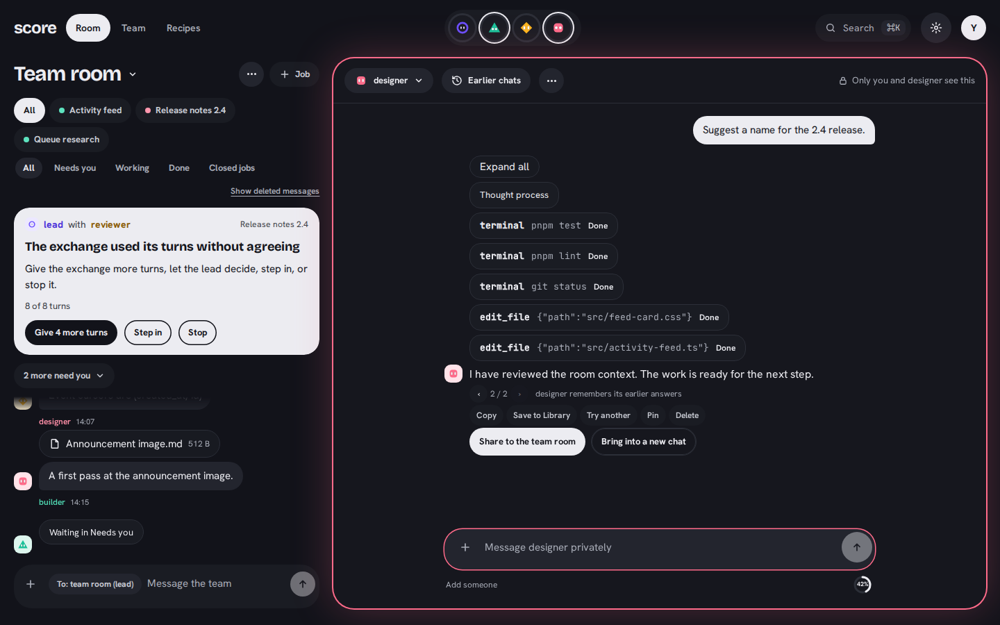

**Try another** asks the agent for a different answer to the same message. The versions stay together as one message with
a pager (on a phone, swipe sideways); your pick is remembered on this device, and the agent remembers its earlier
answers. A failed reply shows **Retry**, and its retry joins the same versions. A deleted message can be undone for a few
seconds, and **Show deleted messages** (under the job filters, or in a chat's ⋯ menu) brings back what was deleted.

### Room tools

The **⋯** menu next to the room name depends on the room:

- **The first team room** (always on, can't be deleted): **Team lead…** (which agent gets unaddressed messages and plans
  lead-decides jobs), **Share a read-only link** and **Export as JSON**.
- **A team you made**: **Rename…**, **Pin** or **Unpin** (pinned rooms list first), **Archive** or **Unarchive** (archived
  rooms hide behind "Show archived"; an open archived room shows a badge with Unarchive), **Team lead…**, **Members…**,
  **Share a read-only link**, **Export as JSON** and a delete.
- **Older rooms**: the same, with **Project…** (choose, create with a colour, or clear; the room list groups by project)
  in place of the two team items.
- **A job's own menu** (on its tab): **Rename…**, **Close** or **Reopen**, **Share a read-only link**, **Export the whole
  room as Markdown** and **Delete job** (undo for about 10 seconds; results saved to the Library stay).

A shared link shows a read-only copy and can be revoked in Settings › System under Shares. Editing a message in a room
with a live share link asks first, because the link still shows the old text.

## More teams

Everyone starts in one team room that holds all agents. You can make others.

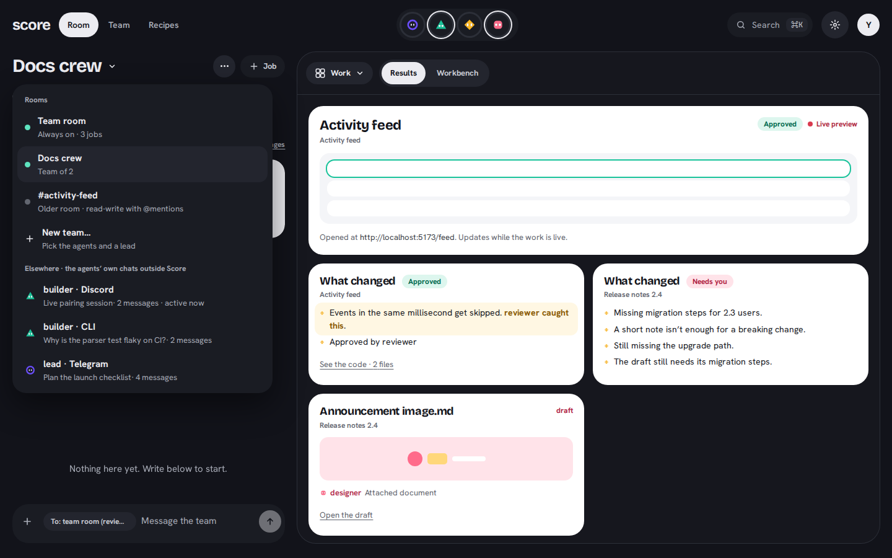

- **New team…** (Team room ▾ › New team…) asks for a name, the members (an agent can be in several teams) and a lead from
  among them.

  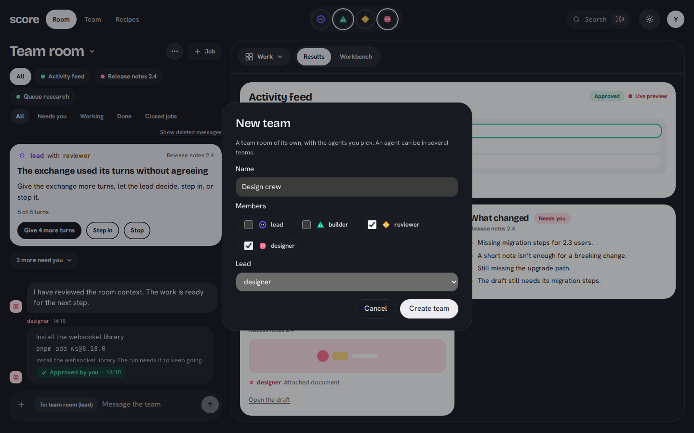

- A team works like the team room: jobs, hand-offs, needs-you cards, recipes and lead-decides runs started there.
- **Members…** and **Team lead…** (from its ⋯ menu) change who is in it and who leads; the lead stays a member until you
  change the lead. A room with a question still waiting for your answer counts as busy and can't be deleted.
- **Switch teams** from the Team room ▾ menu, which also lists older rooms and imported chats.
- **Choosing a team.** Once you have more than one, anything that starts work asks which team: a trigger's **Starts jobs
  in**, **Share to a team** from a one-to-one, **Add someone**, and Elsewhere's **Bring into a job**. A trigger whose
  team was archived or deleted starts its jobs in the first team room. With a single team none of this shows.

  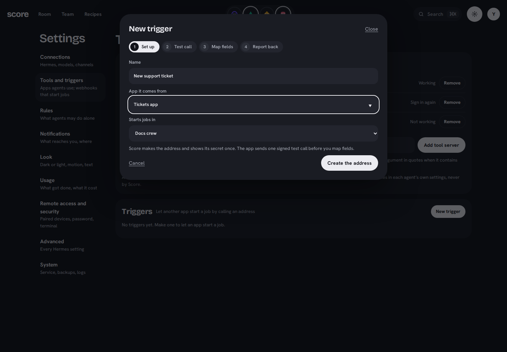

- **Elsewhere** (at the bottom of the menu) lists the agents' own chats outside Score, for example in Discord or the CLI.
  Open one and choose **Preview this chat** to read it (nothing is added to Score and Hermes isn't changed). **Bring into a
  job** then starts a job in the team you choose with those messages attached, and adds an "Imported from …" room. Score
  can't reply in the original chat.

## One-to-ones

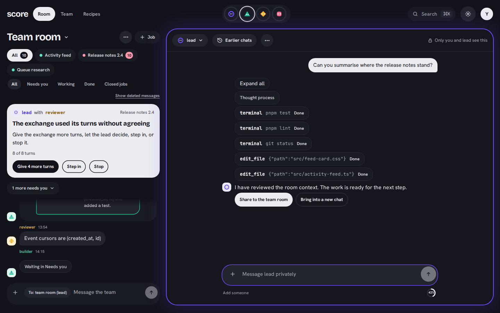

Click an agent in the dock (or **Message** on its page, or type `@` in Search) to open a private chat in the side panel.
Only you and that agent see it, and the panel says so. A ring beside the box shows how much of the agent's context is
used; `/compress` compacts it and `/usage` shows tokens and cost.

- **Earlier chats** lists your earlier chats with that agent (search them; **New chat with …** starts another). The chat's
  ⋯ menu has **Show deleted messages**, **Clear chat** (the main chat) and **Delete chat** (undo for about 10 seconds).
  Both are Score-side only: the agent's Hermes session may still remember.
- **Share to the team room** puts an agent's answer into a job as a frozen copy. With several teams it is **Share to a
  team**: pick the team, then its job. **Bring into a new chat** continues the conversation elsewhere.
- **Add someone** brings in a second agent. A one-to-one has no room for a third, so Score starts a new job in the team
  you pick with this chat referenced, not copied; everyone there sees a frozen summary, and the dialog shows what leaves
  the chat before you confirm. This chat stays as it is.
- The message actions from the room (Edit, Copy, Save to Library, Try another, Pin, Delete) work here too.

## Runs and recipes

### Runs

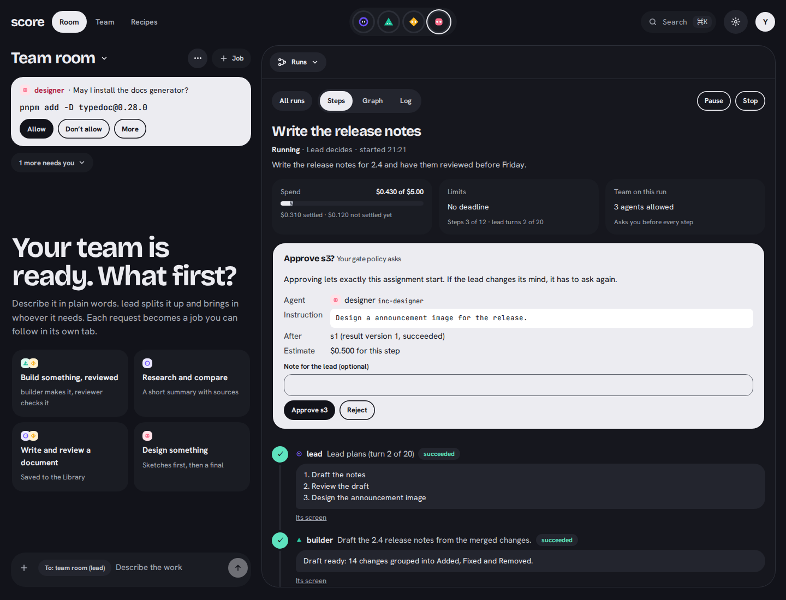

A running job shows under **Runs** in the side panel. The list filters by **Needs you**, **Running** and **Done**. A run
opens as its **Steps**, with what each agent did, its status and reply, and the decisions waiting for you on top. Spend
against its cap, the limits and the agents allowed sit above the steps. A gate (here "Approve s3?") shows exactly what
will start and offers **Approve** or **Reject**, with an optional note for the lead. **Pause** and **Stop** are at the top
of every run. A step has **Its screen** (the agent's [screen page](#the-agents-screen)) and **Details of this step**.

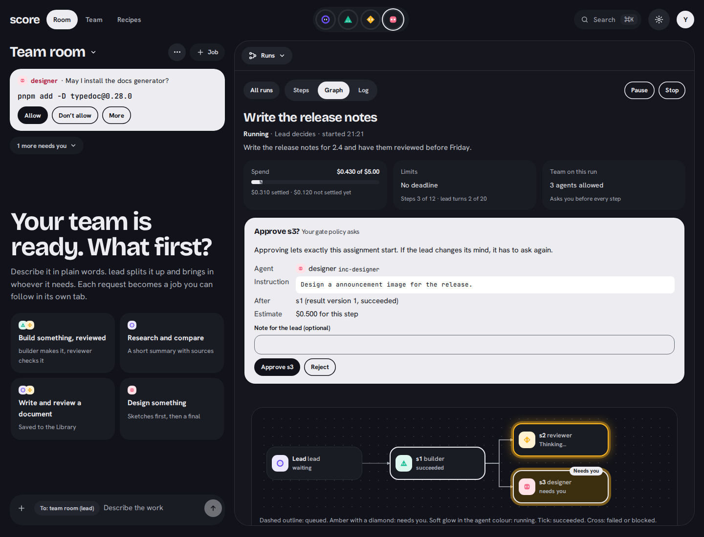

**Graph** draws the same run: queued steps are dashed, running steps glow in the agent's colour, a step that needs you is
amber with a diamond, and finished steps carry a tick. **Log** lists every request the lead made. A lead-decides run also
shows its goal and plan. A recipe run warns when one of its agents was replaced or removed since. A step whose end Score
couldn't confirm is flagged "Not confirmed as ended" and waits for your decision. **Run again…** starts a copy.

### Recipes

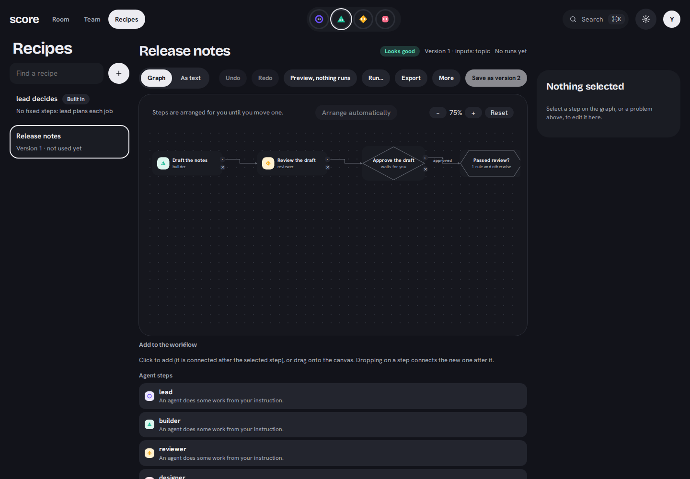

**Recipes** in the top bar lists your recipes and the built-in **lead decides**. A recipe is a saved set of steps: an agent
step, a **Gate** that waits for your OK, a **Branch** on a result, a **Join** that waits for all paths, and an **End**. Edit
it as a **Graph** (add, connect, drag, delete, undo and redo) or **As text** (a step list). Select a step to change its
title, agent, retries and what happens if it fails or is rejected. **Preview, nothing runs** plays it through without
running anything, and Score marks problems as you edit. **Save as version N** stores a new version (a saved version never
changes), **Run…** opens Start a job with the recipe, **Export** downloads it, and **More** holds **Duplicate**, older
versions and **Delete recipe** (only for a recipe nothing has run). While a copy runs, the graph shows it live.

## An agent's page and screen

**Team** lists the agents with their state and role; **Pause everyone** (and Resume everyone) sits at the top. **Add an
agent** offers **New agent**, **Bring in a Hermes profile** (from an archive) and **A coding tool**. Each previews its
changes first and asks where the agent runs (this machine as you, Docker, or another machine over SSH). Reusing a removed
agent's name asks you to tick that.

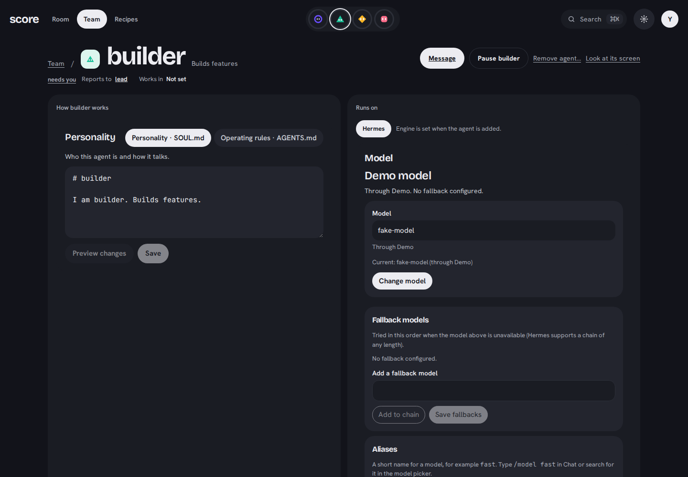

An agent's page has **Message**, **Pause** or **Resume**, **Remove agent…** and **Look at its screen** at the top, and shows
**Reports to** and **Works in**. Then:

- **How it works**: **Personality** (`SOUL.md`) and **Operating rules** (`AGENTS.md`), edited with **Preview changes** and
  **Save** (a conflict check stops you overwriting someone else's edit);
- **Runs on**: the engine, the **Model** and **Fallback models** tried in order;
- **Asks you first before**: things the agent must ask about. You can only make it stricter than the team rules;
- under **More**, compact cards: **Remembers** (search its memory; forgetting a note asks first), **Skills**, **Can use**
  (tools), **Workspace**, **Repeating jobs**, **Goes ahead without asking**, **Never rules**, **Plugins**, **Channels**,
  **Looks** (colour and shape), **Name and role**, **Recent runs** (filter by outcome, with each run's cost), **Score
  access**, **Todo** and **Delete**. Long lists show the first few with "Show all N".

**Removing an agent** opens a panel on the page: what is still going, why Hermes can't remove it yet, where a private copy
goes, then you type the agent's name. It also works for an agent whose setup stopped with an error: the stopped setup is
abandoned first, and if Hermes never made the profile only Score's records are retired. A setup whose last step Score lost
track of asks you to confirm what happened first. A removed agent disappears from the dock, one-to-ones, Search and the
move-chat picker; an old link to its chat still shows the history.

### The agent's screen

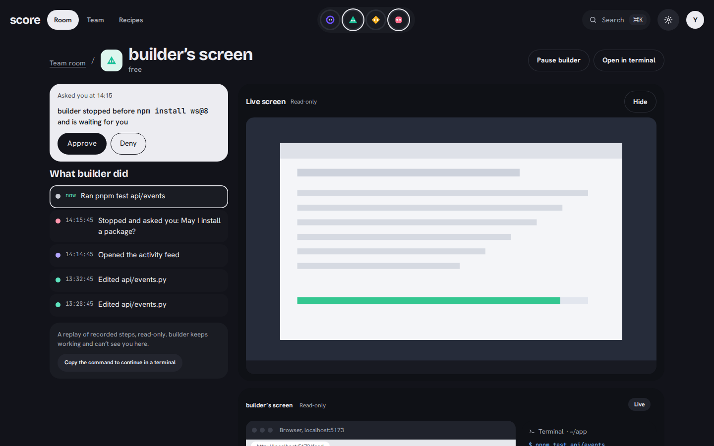

**Look at its screen** (or a step's **Its screen**) replays what the agent did: its steps newest first (**Full history**
for all), the editor large with the terminal and browser as small cards beside it (tap one to swap it in), other screens as
chips, and a replay bar you can scrub, jump along, or set back to **Live**. While the agent works, the large screen follows
what it is using. Whatever it asked you stays pinned above its steps, and a pending approval is answered right there. It is
a replay of recorded steps, not a remote desktop, and it is read-only. **Open in terminal** and **Copy the command to
continue in a terminal** let you carry on the agent's session yourself.

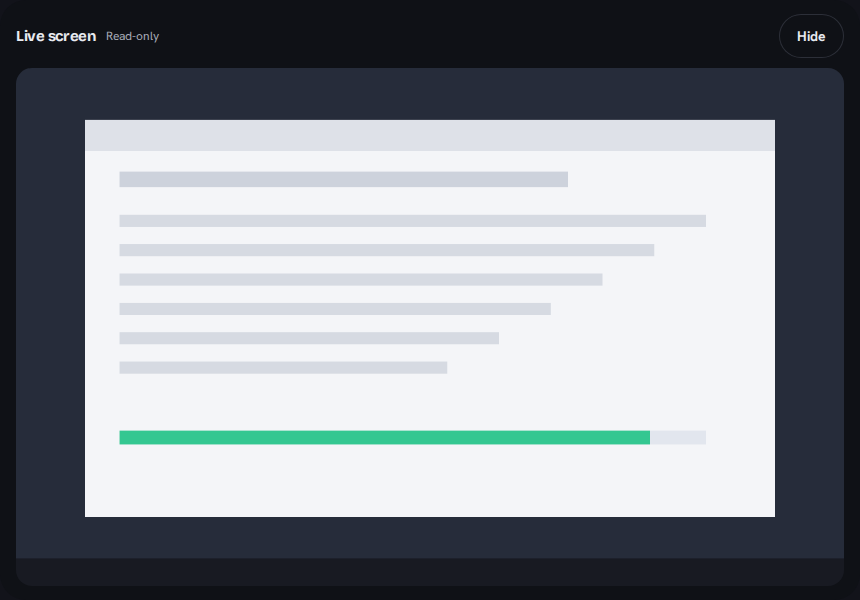

**Live screen.** When the agent has a Hermes Bot Desktop (computer use) running, its screen shows live above the replay
about once a second, marked Read-only. Score only ever asks for pictures: never keys, clicks or the clipboard, and it never
takes control. While someone has taken over the screen in Hermes, nothing is shown, and a screen inside the agent's sandbox
is reported rather than shown. **Hide** and **Show** are remembered per device.

## Library

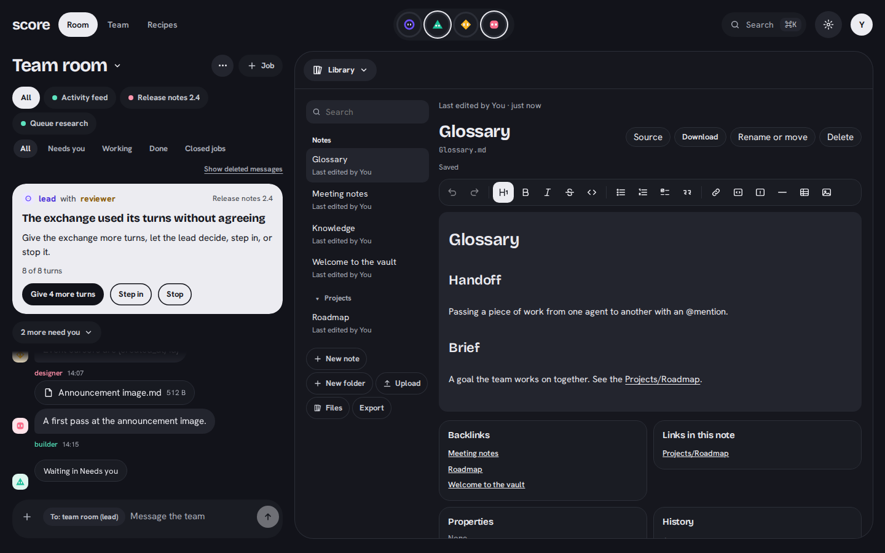

The Library is your notes and files, in the side panel. Notes are Markdown files in a git repository Score keeps
(`~/score-vault` by default), so every save is a commit and **History** shows earlier versions. The list has **New note**,
**New folder** (folders collapse; the folder you pick is where new notes go), **Upload**, **Files** and **Export**, and a
search box. A note opens in a rich editor or as **Source**, with **Download**, **Rename or move** and **Delete**, plus
**Backlinks**, **Links in this note**, **Properties** and **History**. **Save to Library** on a message puts a result here,
and agents can search, read and write notes when Library access is on (Settings › System). Don't keep secrets in notes:
Score can't recognise every one.

## Settings

The gear opens Settings. Its sections, as listed on the left:

- **Connections**: **Hermes** (whether it is reachable), **Model providers** (sign in, add a key, or add a local model with
  an optional key that goes to Hermes and is never kept in Score), messaging channels, **Your phone** and **Other apps**.
  Each connection can be removed after a confirm.
- **Tools and triggers**: the tool servers agents use (Score's own can't be removed here), and **Triggers**, which let
  another app start a job by calling an address. **New trigger** walks through **Set up**, **Test call**, **Map fields** and
  **Report back**. Score shows a signing secret once (calls must be signed and arrive within five minutes), shows the
  redacted test call, and lets you map its fields into the job's text. **Report back** has Score ask the lead to call a
  tool when the job is done. With several teams a trigger has **Starts jobs in**.
- **Rules**: what agents may do alone. **How "Ask me" works** is **Guardian first**, **Always ask me** or **Never ask**,
  with **Go ahead** and **Never** lists next to **Ask me**. When nobody is watching (routines, one-off runs), a command
  that would ask you is blocked instead.
- **Notifications**: browser notifications on this device, for an approval waiting, a routine finished, an agent error or
  an agent reply while Score is in the background.
- **Look**: see below.
- **Usage**: what got done and what it cost.

  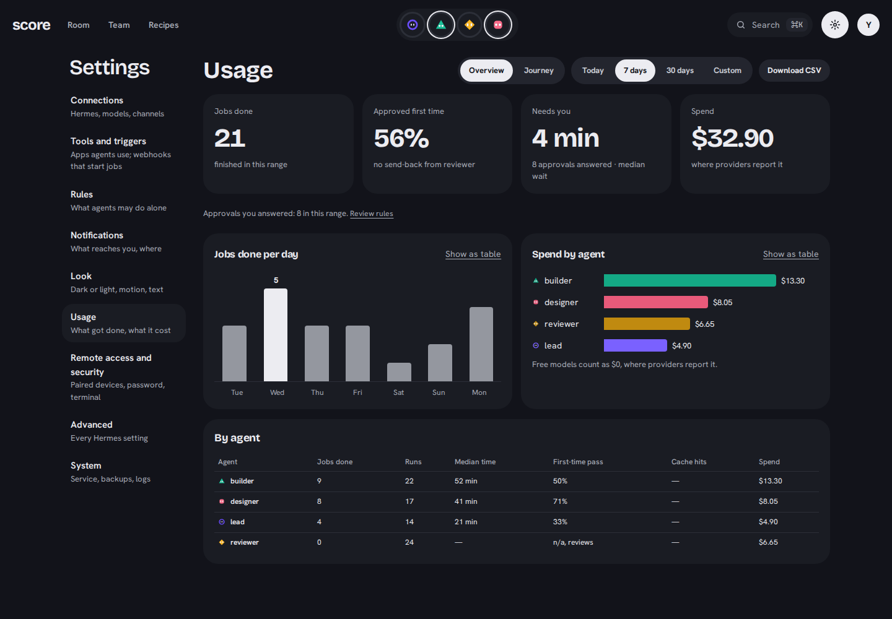

  Pick Today, 7 days, 30 days or a custom range. The overview shows jobs done, approved first time, how long answers took
  you and spend, with jobs per day, spend by agent and a **By agent** table (jobs done, runs, median time, first-time pass,
  cache hits, spend). Spend is marked estimated where Hermes doesn't report it. **Journey** charts tasks, notes, skills and
  memory over time, and **Download CSV** follows the range.
- **Remote access and security**: **Where agents run**, pairing another device, the security password, TLS setup, paired
  browsers and open terminals (listed and closable). The **Terminal** is off unless Score started with `SCORE_TERMINAL=1`.
  It works only over HTTPS in remote mode, asks for the security password set on the host (`scripts/score password`), runs
  as your user, closes after 15 minutes idle, and at most two are open.
- **Advanced**: every Hermes setting, with pending changes listed before they apply.
- **System**: Score's version and updates, **Backups** and restore, **Library access**, **Shares** (read-only links, which
  you can revoke), terminal access, **Logs** and **Pause everyone**.

### Look

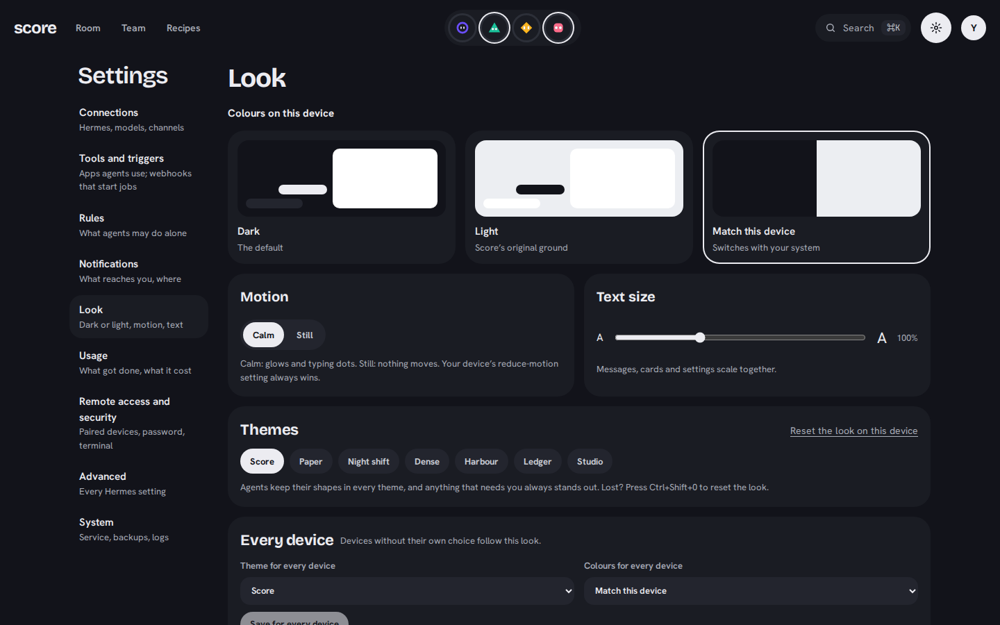

The app is dark by default. **Colours on this device** is **Dark**, **Light** or **Match this device**. **Motion** is
**Calm** (glows and typing dots) or **Still**, and your device's reduce-motion setting always wins. **Text size** scales
messages, cards and settings together. **Send messages with** chooses Enter or Ctrl+Enter. **Themes** picks one on this
device: **Score** (the default), **Paper**, **Night shift**, **Dense**, **Harbour**, **Ledger** and **Studio**. **Every
device** sets the look that devices without their own choice follow (**Save for every device**).

A theme is only data (a settings file, some CSS, fonts or pictures): no theme code runs, and it can't read your data or
press anything for you. Some things never change with a theme: approvals and other decisions, password and permission
screens, the Needs you marker and agent shapes.

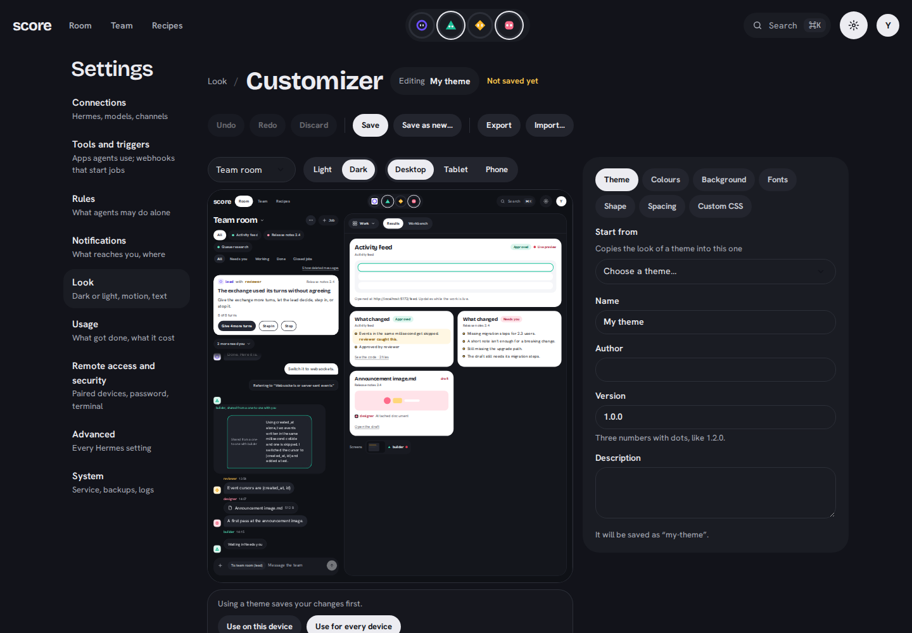

**Open the Customizer** edits a theme against a live preview. Pick the page to preview (Team room, Team, an agent page, an
agent's screen or Settings), **Light** or **Dark**, and **Desktop**, **Tablet** or **Phone** width. The tabs are **Theme**
(name, author, version, and **Start from** to copy another theme), **Colours**, **Background** (a picture, filled or
tiled), **Fonts**, **Shape** (corner roundness, borders, shadows, glass, solid cards), **Spacing** (compact or airy) and
**Custom CSS** (finishing touches only; Score lists what it dropped and why). Score flags colour pairings that are hard to
read, and decisions always keep a solid fill. **Undo**, **Redo** and **Discard** work as you'd expect; **Save** stores the
theme, **Save as new…** keeps the original, and **Use on this device** and **Use for every device** apply it. **Export**
downloads a `.zip` and **Import…** shows an install preview first. A built-in theme is copied before you change it.
Writing a theme by hand is covered in [docs/THEMES.md](THEMES.md).

### Ways back from a broken theme

Any of these takes this device back to Score's own look, and none needs the page to be readable:

1. Press **Ctrl+Shift+0** on any page.
2. Search (⌘K) for "Reset look" and run **Reset look on this device**.
3. Open Score with `?look=safe` at the end of the address, for example `http://127.0.0.1:8740/b?look=safe`. Theme and
   device choice are off for that visit only.
4. **Settings › Look › Reset the look on this device.**
5. On the machine Score runs on, `scripts/score look reset` sets the shared look to Score with the system colour mode,
   even with Score stopped.

If a theme fails to load or damages a protected part such as an approval, Score skips it and says so.

## Coding agents

Claude Code, Codex and Antigravity (`agy`) can join the team next to your Hermes agents: **Team › Add an agent › A coding
tool**. They use your own CLI login and plan quota, so install and sign in to the CLI first. Choose the tool (the form shows
whether it is installed and whether Score has tested its version), a name, a workspace folder and a permission level:

- **Read only**: looks at files, changes nothing;
- **Workspace write**: edits files in its workspace (the default);
- **Full access**: no sandbox, anything it is told runs as your user. It needs the security password, and so does raising
  an agent to it later.

**What they can read.** The level limits what an agent can **change**, not what it can **read**. Claude Code runs with deny
rules for `~/.hermes`, `~/.score`, `~/.ssh` and `.env` files. Codex can read every file your user can, including secrets
outside its workspace; Score can't block that, and you tick an acknowledgement before the agent is created. Antigravity's
sandbox keeps it inside its workspace below full access (and below that level it can't run shell commands). Start a job
asks you to accept what the coding agents in it can read.

**Sessions per job.** A Claude Code or Codex agent keeps one session for each job and agent, resumed on every turn, so it
remembers the job. A step of a recipe or a "lead decides" run starts fresh each time. One turn runs at a time (others queue), a turn stops after 30
minutes, and **Stop** works as for other agents.

An agent's page also has **Personality** (a role line and Markdown instructions, given to the CLI at the start of each
session; **Edit personality**, then **Save**), **Limits left** (its 5-hour and weekly quota bars) and the **quota guard**:
**Stop using this agent in runs when a limit is below** a floor of 0 to 50 percent (10 by default, 0 turns it off). Runs
don't hand it new steps below the floor, and steps already running are never interrupted. A card then asks you to **Use it
anyway**, **Wait until it resets** or **Stop the run**.
